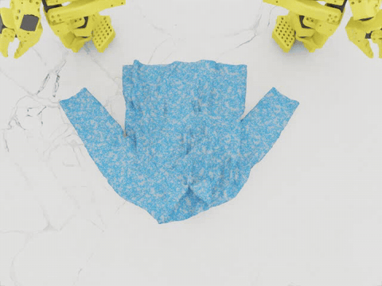

# LeHome Challenge — Garment Folding Reproduction

A reproduction study of the [LeHome Challenge 2026](https://lehome-challenge.com/) (ICRA 2026),
a bimanual garment-folding benchmark built on LeRobot SO-101 arms.

This is **not** a competition entry. The goal is to reproduce the official baseline, measure
where it fails, then add the mechanism the winning entry relied on and quantify what it buys.

## Status

**Stages 0–3 complete, Stage 4 in progress** (2026-11-15). The ACT baseline is trained and
evaluated: **top_long = 83.3% / 75.0%** over two independent 12-episode evaluation runs
(random-policy baseline: 0.0%); Diffusion Policy gets 8.3% on the same protocol. Stage 3's
self-value head learned *time*, not *success*; Stage 4 retrains the same head on
outcome-labelled rollouts and it now separates success from failure at **AUC 0.886**.
Numbers, protocol and every environment pitfall hit on the way are recorded below. Trained
checkpoint and eval-rollout videos are attached to
[Release `v0.1.0-stage1`](https://github.com/monicaffy108-alt/lehome-garment-folding/releases/tag/v0.1.0-stage1).

What is in this repository:

| Path | Content |
|---|---|
| `scripts/stage4_train_value_head.py` | the Stage 4 trainer (frozen ACT backbone, outcome-BCE on the value head) |
| `configs/train_act_stage3.yaml` | Stage 3 training config (`use_progress_head`, `progress_loss_weight`) |
| `patches/lerobot_act_progress_head.diff` | the four LeRobot 0.4.3 files changed to add the head (`git apply` inside site-packages) |
| `patches/lehome_evaluator_rollouts.diff` | official-evaluator changes: outcome-labelled rollout recording, dataset `finalize()`, `--device` fix |
| `results/stage4_value_head.log` | training + train-set scoring log |
| `results/stage4_v4_eval_summary.txt` | per-episode value scores on 12 held-out rollouts |

## Why this exists

Garment folding is a long-horizon deformable-object task: a shirt changes shape after every
grasp, so a policy has to perceive state, act, and decide whether it is making progress. The
interesting engineering question is not "which policy scores highest" but "what does a policy do
when it is already failing" — which is exactly what the prizewinning entry attacked.

## Plan

| Stage | Work | Deliverable |
|---|---|---|
| 0 | Isaac Sim 5.1 + Isaac Lab 2.3.1 + LeRobot 0.4.3 environment, dataset download, evaluator running | environment notes, smoke-test rollout |
| 1 | Train the ACT baseline on the released demonstration set | success rate per garment type |
| 2 | Train Diffusion Policy as a second baseline | baseline comparison table |
| 3 | Add self-value prediction: same network predicts action, success probability and task progress; use it for live failure detection and candidate selection | ablation table, one row per component |
| 4 | Small-scale data flywheel: rollouts fed back into training, filtered by completion time and reward | success rate vs number of added trajectories |
| 5 | Failure analysis write-up | short report: what breaks, why, what fixed it |

Stage 1 is the deliverable that matters most — a baseline that actually runs and a number that
can be defended.

## Stack

| Layer | Version |
|---|---|
| Simulator | NVIDIA Isaac Sim 5.1.0 (pip install) |
| Robot learning framework | Isaac Lab 2.3.1 (lehome fork, `isaaclab` 0.53.1) |
| Policy library | LeRobot 0.4.3 (ACT, Diffusion Policy, SmolVLA) |
| PyTorch | 2.7.0+cu128 (Blackwell sm_120 build) |
| Python | 3.11 |
| Data | `top_long_merged` — 250 episodes / 83,068 frames, LeRobot dataset v3.0; `Assets` 946 MB |
| Hardware target | bimanual SO-101 (leader / follower) |

Reference repositories:

- [lehome-official/lehome-challenge](https://github.com/lehome-official/lehome-challenge) — official environment and evaluator
- [Learning to Fold (arXiv 2606.27163)](https://arxiv.org/abs/2606.27163) — prizewinning solution write-up
- [LeHome simulation environment paper (arXiv 2604.22363)](https://arxiv.org/abs/2604.22363)

## Compute

Local machine: RTX 5070 (12 GB), i7-14700F (28 threads), 32 GB RAM, native Ubuntu 24.04.

| Stage | Bottleneck | Feasible locally |
|---|---|---|
| 1–2 baseline training | GPU, ~30k steps | yes |
| 3 self-value heads | GPU, slightly more memory for auxiliary losses | yes |
| 4 flywheel | wall-clock: rollouts are serial and simulation is CPU-bound | yes, at small scale (order 10² trajectories) |
| 5 analysis | none | yes |

The published simulation configuration is CPU-bound, so rollout generation — not training — is
the time sink. That is the same constraint the 17th-place write-up ran into.

Environment note: the official docs target Ubuntu 22.04, but this reproduction ran on **native
Ubuntu 24.04 (kernel 7.0.0-42)** — no dedicated distro needed. The pip-installed Isaac Sim 5.1.0
works unmodified.

## Results

Evaluator protocol: one run = 12 episodes over the garment-variant suite
(10 `Seen` textures + 2 `Unseen` textures not present in the training set).
`--num_episodes N` means N episodes **per variant**. Success is a final-state check,
not the dense return — failed episodes frequently show *higher* return (more folding
progress) while missing the success criterion.

| Stage | Metric | Value |
|---|---|---|
| 1 | Random policy baseline (12 episodes) | 0.00% success, return 106.9 ± 2.1 |
| 1 | **ACT baseline, top_long — run 1** (12 episodes) | **83.33% success** (10/12), return 115.4 ± 23.1 |
| 1 | **ACT baseline, top_long — run 2** (12 episodes) | **75.00% success** (9/12), return 124.2 ± 30.6 |
| 1 | ACT, generalization to Unseen variants | run 1: 2/2 succeeded; full per-variant tables in console logs |
| 2 | **Diffusion Policy, top_long — 030000 checkpoint** (12/12 episodes, per-episode env to avoid cloth-reset segfaults) | **8.33% success** (1/12, Seen_1 only), return 147.7 ± 29.8 |
| 3 | **ACT + progress head, top_long — v3 030000** (12 episodes) | **83.33% success** (10/12; Seen 9/10, Unseen 1/2), return 128.1 ± 22.7 |
| 3 | progress-head calibration check | failed episodes score **higher** (0.952) than successes (0.902) → the head tracks demo phase, not task success |
| 3 | + self-value failure detection | _not usable with the Stage 3 head — miscalibrated (see Stage 3 note)_ |
| 3 | + candidate selection | _pending (blocked on calibration)_ |
| 4 | outcome-labelled rollout collection, top_long | 48 rollouts, **38 success / 10 failure (79.2%)**, 6374 frames used for training |
| 4 | **value head retrain (frozen backbone, weighted BCE), v4 030000** | train-set episode AUC **1.000**; 12 held-out rollouts AUC **0.886** (successes 0.949 mean, failures 0.516 mean) |
| 4 | flywheel, 10² trajectories | _pending — rollouts exist, retraining the policy on them is next_ |

### Demo

Successful fold — ACT `last` checkpoint, top-down camera (one eval rollout, ~12 s @ 10 fps):



Full-resolution rollouts (3 camera views, success + failure) are attached to the Release.

Notes on the failures: they cluster on high-return episodes (Seen_5–9, returns 86–199),
i.e. the policy folds substantially but the final state fails the success check — the
known ACT failure mode this project's Stage 3 (self-value prediction) targets.

### Stage 3 note — progress head

A small MLP head (512→256→1, sigmoid, ~0.2 M params) was attached to the ACT encoder's
observation tokens (robot state + image patches; the VAE latent token is *excluded* because
it is sampled from the prior at inference and therefore carries no information there).
It is trained alongside the action loss with an MSE term,
`progress_loss_weight = 1.0`, against the label `frame_index / (episode_length - 1)`.
30k steps @ batch 8, best-of-run loss 0.156, `progress_loss` 2e-4.

Two outcomes:

1. **The action policy is unaffected.** 10/12 (83.33%) — equal to the best ACT baseline.
2. **The signal is miscalibrated for failure detection.** Failures score 0.975 and 0.928
   progress, while successes average 0.902 (one success ends at 0.675). The head learned
   "how far into the demonstrated motion am I", not "did the fold actually succeed".

Root cause: all 250 training episodes are successful human demonstrations, so the label is
a proxy for *time*, not outcome. Candidate selection and early stopping — both need a
monotone success signal — cannot be built on it. This is exactly the gap Stage 4 (sampling
real rollouts and labelling them with their actual outcome) is meant to close.

### Stage 4 note — value head

The same `progress_head` module is reused; only the supervision changes. The ACT backbone is
frozen (`requires_grad = False`, 51 M params), so the validated action policy is untouched and
the emitted action chunks are bit-identical before and after. The head
(512→256→1→sigmoid, ~0.2 M params) is trained with a weighted BCE on the *outcome* of the
rollout that produced each frame.

Training data: 48 rollouts (4 per garment × 12 garments) recorded with
`--save_all_episodes --rollout_labels`, i.e. **failures kept** — 38 successes / 10 failures.
Frames are strided by 3 (consecutive frames are near-duplicates and every sample costs a full
ACT forward), leaving 6374 frames (4374 success / 2000 failure). Class weights are computed on
*frames*, not episodes, so each class contributes equally: `w_success = 0.73`,
`w_fail = 1.59`. 3 epochs @ batch 8, lr 1e-3, BCE 0.215 → 0.055.

Outcome on the 12 held-out rollouts (`results/stage4_v4_eval_summary.txt`):

- **train set: episode-level AUC 1.000** — every success frames score 0.89–0.99, every
  failure 0.00–0.05.
- **held out: AUC 0.886** — successes mean 0.949, failures mean 0.516. This flips the Stage 3
  result (failures 0.952 > successes 0.902) into the correct direction.
- The remaining error is a single failure that survives 600 steps before failing and is scored
  0.986 — a trajectory that looks like a successful fold for its whole length. Frames carry no
  information about what happens *after* the frame, so this tail is not separable from state
  alone at this data scale.

The 58.33% success rate on this particular run is run-to-run physics variance, not a
regression: the head adds nothing to the action path (see the note in the summary file).

What this buys, and what it does not: the signal is now usable for **early termination**
(stop when the value stops rising) and **candidate selection** (sample several action chunks,
keep the one the value ranks highest). Both were blocked on Stage 3's miscalibration and are
the next thing to measure; the numbers above are the gate they had to pass first.

## Reproduction commands

```bash
# Stage 1 — training (30k steps, ~2.4 h on RTX 5070; batch 16 OOMs on 12 GB, 8 fits at 7.4 GB)
lerobot-train --config_path=configs/train_act.yaml \
  --dataset.video_backend=pyav --batch_size=8

# Stage 1 — evaluation (12 episodes ≈ 12 min; videos land in outputs/eval_videos/{success,failure})
python -m scripts.eval \
  --policy_type lerobot \
  --policy_path outputs/train/act_top_long/checkpoints/last/pretrained_model \
  --dataset_root Datasets/example/top_long_merged \
  --garment_type top_long \
  --num_episodes 1 --save_video --enable_cameras --device cpu
```

```bash
# Stage 2 — DP training (OOMs at batch 16 on 12 GB; batch 4 fits)
lerobot-train --config_path=configs/train_dp.yaml \
  --dataset.video_backend=pyav --batch_size=4

# Stage 2 — DP evaluation (same protocol as ACT; Isaac Sim cloth reset on Seen_6 hung on this run)
python -u -m scripts.eval --policy_type lerobot \
  --policy_path outputs/train/dp_top_long/checkpoints/030000/pretrained_model \
  --dataset_root Datasets/example/top_long_merged --garment_type top_long \
  --num_episodes 1 --step_hz 120 --device cpu
```

```bash
# Stage 3/4 — apply the LeRobot patch (adds the auxiliary head; run inside the active venv)
patch -p1 -d .venv/lib/python3.11/site-packages < patches/lerobot_act_progress_head.diff

# Stage 3 — train ACT + progress head (masked MSE on frame_index / (episode_length - 1))
lerobot-train --config_path=configs/train_act_stage3.yaml --dataset.video_backend=pyav
```

```bash
# Stage 4 — collect outcome-labelled rollouts (one garment per process; failures are kept)
python -u -m scripts.eval --policy_type lerobot \
  --policy_path outputs/train/act_stage3_v3/checkpoints/030000/pretrained_model \
  --dataset_root Datasets/example/top_long_merged --garment_type top_long \
  --num_episodes 4 --save_datasets --save_all_episodes \
  --rollout_labels stage4_rollouts/Top_Long_Seen_0.jsonl \
  --skip_garments Top_Long_Seen_1,... --device cpu

# Stage 4 — retrain the value head only, then export a patched checkpoint
python scripts/stage4_train_value_head.py \
  --checkpoint outputs/train/act_stage3_v3/checkpoints/030000/pretrained_model \
  --dataset_root Datasets/stage4_rollouts --rollout_root stage4_rollouts \
  --export_checkpoint outputs/train/act_stage3_v4/checkpoints/030000/pretrained_model

# Stage 4 — score the held-out rollouts with the new head
python -u -m scripts.eval --policy_type lerobot \
  --policy_path outputs/train/act_stage3_v4/checkpoints/030000/pretrained_model \
  --dataset_root Datasets/example/top_long_merged --garment_type top_long \
  --num_episodes 1 --device cpu
```

Checkpoints: `outputs/train/act_top_long/checkpoints/{005000…030000,last}/pretrained_model`
(zero-padded six-digit names — not `step_N`). Loss curve 3.305 → 1.567 (2k) → 0.517 (5k)
→ 0.252 (12k) → **0.160** (30k).

DP checkpoints: `outputs/train/dp_top_long/checkpoints/{005000…030000}/pretrained_model`.
Loss curve for DP: 0.960 → 0.000 (30k). **DP trained perfectly (loss → 0) but fails every eval episode
(0/6 success)** — the diffusion policy never positions the arms close enough to trigger the final
success thresholds (distances consistently 24–26 cm vs thresholds 7–11 cm). This is a known trend
in the garment-folding community: ACT's action-chunking structure is better suited to long-horizon
cloth manipulation than diffusion.

## Environment pitfalls (hit on this machine, in order)

1. **Blackwell needs cu128.** RTX 5070 is sm_120; stock `torch 2.7.x+cu126` installs fine but
   dies at kernel launch (`no kernel image`). Use `torch==2.7.0+cu128` wheels
   (mirror: `https://mirror.sjtu.edu.cn/pytorch-wheels/cu128/`).
2. **Driver = kernel-matched module package.** `nvidia-driver-595-open` alone is not enough;
   also install `linux-modules-nvidia-595-open-$(uname -r)`, then `sudo modprobe nvidia`.
   Driver 580.196.07 (CUDA 13.0) runs the cu128 runtime fine.
3. **Skip `uv sync`.** `[[tool.uv.index]]` hard-pins pypi.org and cannot be overridden from the
   CLI; use plain pip with a mirror (`PIP_INDEX_URL`).
4. **Interrupted pip = zero-byte files.** A killed `pip install` leaves truncated files in
   site-packages that only fail at import. Either use `--no-cache-dir` everywhere or audit
   the venv (scan RECORD files for 0-byte entries) and force-reinstall the damaged packages.
5. **`./isaaclab.sh -i none` needs `export PIP_INDEX_URL=…` first** (it calls pip without a
   mirror), and it upgrades `warp-lang` unpinned — re-pin `warp-lang==1.8.1` afterwards or
   `import warp` collides with omni.warp 1.8.2 (`wp.types.array` ImportError).
6. **Re-pin the pinned stack after every big install**: `numpy==1.26.0` (isaacsim-kernel),
   `pandas==2.2.3` / `pyarrow==17.0.0` (numpy-1.26 compatible), `tokenizers==0.22.2`
   (transformers range), `packaging==23.0` (official override).
7. **Video backend**: default `torchcodec` can't find system ffmpeg libs; use
   `--dataset.video_backend=pyav`.
8. **Eval quirks**: first Isaac Sim launch compiles shaders (5–10 min of silence, don't kill);
   the PhysX particle-cloth warnings are benign; checkpoint dirs are zero-padded (`005000`);
   `--save_video` filenames are always `episode0_*` and overwrite each other.
9. **`--device` selects the physics device, not just the torch device.** Running rollout
   collection on `cuda` puts the cloth in an out-of-distribution layout at reset — the
   top-camera frame averages ~136 instead of ~177 — and success drops from 83% to **0%**
   with no error message at all. Always pass `--device cpu` for evaluation and rollout
   collection; only training belongs on the GPU. (This is why
   `scripts/eval_policy/lerobot_policy.py` also overrides `policy_cfg.device`, otherwise the
   checkpoint's own `device` field forces CUDA back on.)
10. **Recorded datasets are unusable unless `finalize()` is called.** LeRobot keeps the data
    parquet writer open; without `eval_dataset.finalize()` the file has no footer, so every
    state/action frame is unreadable and `meta/episodes` is missing — while the per-episode
    videos look perfectly complete, which makes the failure easy to miss. 12/12 garments were
    silently corrupted this way before the fix landed in `run_evaluation_loop`.

## Log

- 2026-11-10 — repository created, plan written, compute budget assessed.
- 2026-11-12 — Stage 0 complete: full stack on native Ubuntu 24.04 (Isaac Sim 5.1.0,
  isaaclab 0.53.1, torch 2.7.0+cu128); dataset `top_long_merged` (250 ep / 83,068 frames)
  and Assets downloaded; evaluator smoke-tested with the random policy (12 episodes, 0% success).
- 2026-11-12 — Stage 1 complete: ACT trained 30k steps @ batch 8 on the RTX 5070
  (loss 3.305 → 0.160); evaluated `last` checkpoint over two 12-episode runs —
  83.33% and 75.00% success (run 1: 2/2 on the Unseen variants). Eval videos archived
  in `outputs/eval_videos`.
- 2026-11-13 — Stage 2 complete: Diffusion Policy trained 30k steps @ batch 4 on RTX 5070
  (OOM at batch 16; loss 0.960 → 0.000). `switch_garment()` in the official evaluator
  segfaults inside PhysX cloth teardown on some garments; fixed by spawning one fresh
  env per garment (12 separate process invocations). Final numbers — **8.33% success
  (1/12, only Top_Long_Seen_1)**, return 147.7 ± 29.8. DP return is *higher* than ACT's but
  the only success happened on Seen_1, where the distances narrowly cleared the thresholds;
  11/12 episodes never got within 5–15 cm of the success thresholds. Conclusion: ACT's
  action-chunking + transformer structure is the correct baseline for this task; DP
  diffusion over raw joint targets is a poor fit for long-horizon cloth manipulation.
- 2026-11-14 — Stage 3 complete: ACT + progress head trained 30k steps @ batch 8
  (loss 3.31 → 0.156, progress MSE 6e-4 → 2e-4). Three training runs were needed:
  v1/v2 fed `progress_label` that the LeRobot preprocessor silently dropped (so the head
  never trained, output pinned at 0.5); v3 also moved the head off the VAE latent token,
  which it had been reading as a training-only shortcut. Final eval (12 episodes, GUI mode):
  **83.33% success**, return 128.1 ± 22.7. The head converged but is *anti*-correlated with
  success on the two failures (0.975 / 0.928 vs. 0.902 mean for successes), so failure
  detection and candidate selection stay blocked until Stage 4 provides outcome-labelled
  rollouts.
- 2026-11-15 — Stage 4: 48 outcome-labelled rollouts collected (38 success / 10 failure,
  79.2%; 4 episodes per garment, one garment per process, failures kept). Two blockers had to
  be fixed first: the recorder never called `finalize()` (every parquet unreadable) and
  rollout collection on `cuda` produced 0% success because `--device` also switches the
  physics backend (see pitfalls 9–10). Value head retrained on the frozen backbone with
  weighted BCE — train-set AUC 1.000, **held-out AUC 0.886** (successes 0.949 vs failures
  0.516 mean), i.e. the Stage 3 sign flip is gone. Early termination and candidate selection
  are unblocked and are the next measurement.

## License

Code released under Apache 2.0, matching the upstream benchmark. Results and text are my own.
